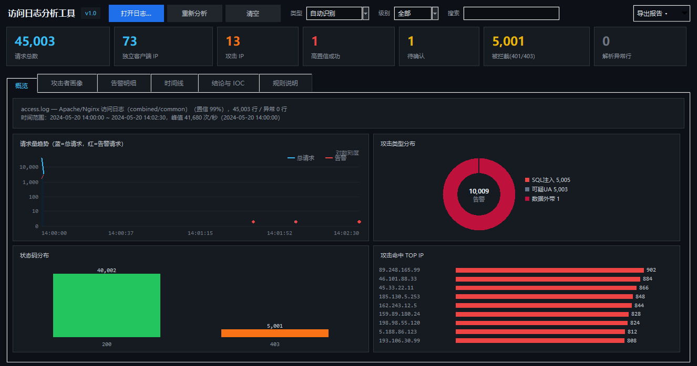
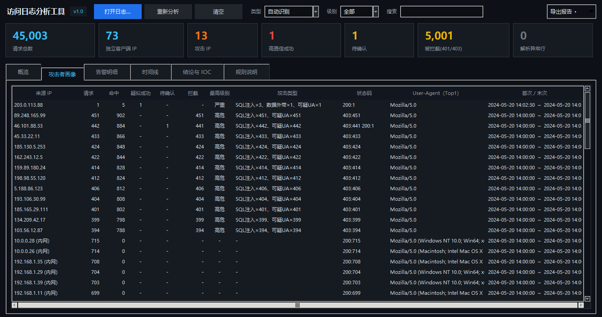
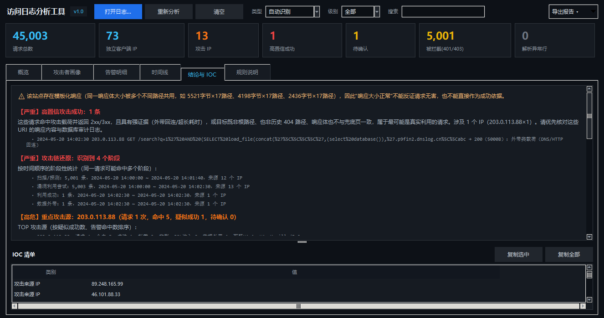

# 访问日志图形化分析工具

把应急响应里"看 access.log"的经验固化成一套**可复现的规则**，配一个 Windows 桌面界面。
单文件、纯 Python 标准库（tkinter），不需要 `pip install` 任何东西，日志不出本机。

```
python log_analyzer_gui.py
python log_analyzer_gui.py D:\logs\access.log        # 启动即分析
```

> 环境：Windows + **Python 3.9 及以上**（实测 3.9.9 与 3.12 均可）。

---

## 〇、三种启动方式

| 方式 | 操作 | 说明 |
|---|---|---|
| **双击** | 双击 `启动工具.bat` → 点「打开日志…」 | 最省事 |
| **拖拽** | 把 `.log` 文件拖到 `启动工具.bat` 图标上 | 直接分析该文件 |
| **命令行** | `python log_analyzer_gui.py D:\logs\access.log` | 会带控制台，出错能看到报错 |

无界面批量导出：

```bash
python log_analyzer_gui.py access.log --html 报告.html --csv 告警.csv --json 结果.json
```

### 快捷键

| 按键 | 作用 |
|---|---|
| `Ctrl+O` | 打开日志 |
| `F5` | 重新分析 |
| `Ctrl+E` | 直接导出 HTML 报告 |
| `Ctrl+F` | 聚焦搜索框 |
| `Esc` | 清空搜索 / 复位筛选（逐级） |
| `Ctrl+1` ~ `Ctrl+6` | 切换标签页 |

界面上点「快捷键」按钮也能看到这份表。

---

## 一、为什么不是"又一个 grep 美化版"

日志分析最容易出两种错：

| 错误 | 后果 |
|---|---|
| 看到攻击特征就报"被打穿了" | 把扫描当入侵，误报满天飞 |
| 看到 404 / 200 就下结论 | 漏掉真正的利用成功 |

所以这个工具把**判定逻辑写死成三级**，每一级都给出依据：

| 判定 | 条件 | 界面表现 |
|---|---|---|
| **疑似成功** | 攻击载荷 + 2xx，且具备**强证据**：外带回连（DNSLog 等）、盲注超长耗时（≥3s）；或目标是真实存在、响应异常的路径 | 红色，置顶 |
| **待确认** | 攻击载荷 + 2xx，但目标是根路径、历史 404 路径、或响应大小与大量正常页面一致（模板页） | 黄色，明确写"证据不足" |
| **仅探测** | 攻击载荷但全部被 403/401/404 拦下 | 只计入统计，不算成功 |

并且会主动识别**兜底页/模板页陷阱**：如果同一个响应大小被很多不同路径共用，工具会在结论区提示"响应大小不能作为成功依据"——这正是纯 grep 分析最容易翻车的地方。

---

## 二、界面：六个标签页

### 1. 概览
先定性、再定量：文件类型与置信度、行数、解析异常数、时间范围、**每秒峰值**，再看四张图
（请求趋势 / 攻击类型分布 / 状态码分布 / Top 攻击 IP）。图表是 Canvas 自绘，无外部依赖。

趋势图在数据高度不均衡（比如一次爆发占满全程）时自动切换**对数刻度**；时间点稀疏时
只画点、不跨空洞连线，避免画出误导性的斜线。

### 2. 攻击者画像
每个来源 IP 一行：请求数、告警命中、**疑似成功**、**待确认**、拦截数、最高级别、攻击类型、
状态码分布、UA、首末时间。表格排序优先"疑似成功 + 严重度"，双击可跳到该 IP 的全部请求。

### 3. 告警明细
按严重度排序的告警流，列顺序把**判定**放在最前面。可按级别过滤、全局搜索 IP/URI/UA，
双击任意行弹出**原始日志行 + 命中规则明细**。

### 4. 时间线
顶部是**攻击链还原**（扫描/探测 → 漏洞利用尝试 → 利用成功 → 落地/写入 → 数据外带，
每个阶段给出条数、时间范围、来源 IP 数），下面是按严重度优先排序的事件流。

### 5. 结论与 IOC
自动生成的中文结论（可直接粘进报告），包括：成功判定及依据、攻击规模与拦截率、
重点攻击源、攻击链、以及**判定口径说明**（告诉看报告的人"这个结论是怎么来的"）。
下方 IOC 清单按类别列出攻击 IP、扫描器 UA、被成功访问的敏感路径、攻击载荷、涉及账号，
支持一键复制。

### 6. 规则说明
把所有规则（编号/名称/类别/级别/**正则原文**/说明）摊开——分析过程必须可解释，
每一条告警都能对回具体规则。





---

## 三、规则库（22 条正则 + 12 类内置规则）

| 类别 | 覆盖内容 |
|---|---|
| SQL 注入 | UNION 查询、布尔盲注、时间盲注、元数据/文件读写、**引号闭合探针**、注释截断 |
| 数据外带 | DNSLog / Burp Collaborator / ceye 等回连通道 |
| XSS | 脚本标签、事件处理器、伪协议、UA 注入 |
| 路径遍历 | 多级 `../`、系统敏感文件、`php://` 伪协议、WEB-INF |
| 命令执行 | `cmd.exe`/`powershell`/`winnt/system32`、Shell 拼接与命令替换 |
| 敏感路径 | 配置/凭据（`.env`、`.git`、`web.config`）、备份与数据库文件、管理后台 |
| 已知组件 | Struts2 OGNL、Log4j JNDI、PHP-CGI 参数注入、XMLRPC/WebDAV |
| IIS 特性 | Unicode 解码遍历（`%c0%af`）、`::$DATA` 备数据流、短文件名 |
| 扫描器 | 30 种工具 UA 指纹（sqlmap/nikto/nmap/gobuster/ffuf/nuclei/burp…） |
| 可疑 UA | 空 UA、**裸 `Mozilla/5.0`**（伪造）、极短 UA |
| 异常方法 | TRACE / PUT / DELETE / OPTIONS / PROPFIND / MKCOL / CONNECT |

**聚合类行为检测**（比单条规则更能说明问题）：
目录扫描（404 占比）、WAF 批量拦截、**同一载荷来自多个 IP（分布式/僵尸网络）**、
**404→200 路径翻转（疑似上传落地）**、写入/上传调用、登录爆破、慢请求、内网来源提示。

加规则很简单，在文件顶部 `RULES` 里追加一行即可：

```python
_r("SQLI-008", "SQL注入-堆叠查询", "sqli", "critical",
   r";\s*(select|insert|update|delete)\s", needles=[";"]),
```

---

## 四、导出

右上角「导出报告」：

- **HTML 报告**：单文件、深色主题、含 KPI/结论/画像/告警表/IOC，可直接交付或归档
- **CSV**：一行一条告警，含判定与判定依据、原始日志（Excel 可直接打开）
- **JSON**：结构化结果（summary / profiles / conclusions / insights / alerts），便于二次处理

也支持无界面批处理：

```bash
python log_analyzer_gui.py access.log --html 报告.html --csv 告警.csv --json 结果.json
python log_analyzer_gui.py access.log --type web_iis --html 报告.html   # 强制指定类型
```

---

## 五、支持的格式

| 格式 | 说明 |
|---|---|
| Apache / Nginx `combined`、`common` | 含 referer/UA 的完整格式，自动识别 |
| IIS W3C 扩展日志 | 读取 `#Fields:` 头，字段顺序自适应，支持 `sc-bytes`/`time-taken` |
| `.gz` / `.zip` | 直接选择压缩包，内置解压 |
| Linux auth / Windows 事件 / 数据库日志 | 能识别并给出提示，但**不做深度分析**（本工具聚焦访问日志） |

实测：45,003 行的 `access.log` 约 **3~5 秒**完成解析 + 检测（含 10,009 条告警）。

---

## 六、一个真实样例的结论（`示例/`）

`示例/access.log-分析报告.html` 是对一份 45,003 行日志的分析结果，要点：

- 12 个外部 IP 在 **2 秒内**发起 5,001 次 SQL 注入探测（同一载荷模板 → 判定为工具批量执行）
- WAF 拦截 5,001 次（403，响应固定 1024 字节）
- **漏掉 2 条**：
  - `203.0.113.88` 的 `load_file + dnslog.cn` 外带注入 → **200 / 5000 字节** → 判定**疑似成功**（外带强证据）
  - `46.101.88.33` 的 `/product?id=1'` → 200 / 3000 字节，但响应大小与正常商品页一致 → 判定**待确认**
- 正常业务：60 个内网 IP、40,000 次 `/product` 请求

这正是"重规则 + 重证据"的价值：既不放过 DNS 外带这种铁证，也不把模板页 200 当成功。

---

## 七、局限（写在明处）

1. **没有响应体**。访问日志只有状态码和字节数，无法看到页面内容——所以工具区分"疑似成功/待确认"，
   而不是直接下"已失陷"。最终定性仍需结合应用日志、数据库审计、文件时间戳。
2. **日志可能被截断**。分析前请确认时间范围是否覆盖攻击全过程，轮转日志（`access.log.1.gz`）要一起选中。
3. **时区**。Apache/IIS 时间按日志字面时间显示，不做时区换算；与主机日志对齐时需自行确认。
4. **反向代理场景**。若前面有 Nginx/CDN，`c-ip` 可能是代理地址，真实 IP 需看 `X-Forwarded-For`（本工具读的是日志本身字段）。
5. 默认只显示前 3,000 条告警（表格性能），完整数据请导出 CSV/JSON。

---

## 八、文件说明

```
log_analyzer_gui.py          单文件工具（引擎 + 界面 + 导出，约 2100 行）
启动工具.bat                  双击启动器（自动找 Python，带拖拽支持）
截图\                        各标签页界面截图（*-优化后.png 为 2026-10 优化版）
示例\access.log-分析报告.html  对 45,003 行日志的实际输出，可直接打开看效果
README.md                    本文档
```

---

## 九、本次界面优化与缺陷修复（2026-10）

### 修复的缺陷

| # | 问题 | 影响 | 处理 |
|---|---|---|---|
| 1 | `_DC_SLOTS = {slots: True} if ...` 中的 `slots` 是未定义变量 | **Python 3.10+ 上启动即崩**（`NameError`），3.9 反而正常 | 改为 `{"slots": True}` |
| 2 | 窗口按整屏尺寸定位 | 1366×768 上窗口底部压到任务栏下面，**状态栏看不见** | 改用 `SPI_GETWORKAREA` 取工作区，按可用区域居中 |
| 3 | 状态栏在 Notebook 之后 `pack` | Notebook 的 `expand` 把状态栏挤成 0 高 | 状态栏先 `pack(side="bottom")` |
| 4 | 结论文本框默认 24 行 | Panedwindow 初始空间被吃光，**IOC 表只剩一条缝** | 显式 `height=9` + 映射后设置分割线位置 |
| 5 | 分析进行中关闭窗口 | `after()` 在已销毁的窗口上继续轮询，抛 `TclError` | 加 `_closing` 标志与 `winfo_exists()` 守卫 |
| 6 | 分析中点击「清空」 | 旧分析结果仍会渲染回来，覆盖清空后的界面 | 引入分析代次 `_gen`，过期结果直接丢弃 |
| 7 | 「载入示例」式的解析失败 | 旧图表/表格残留，看起来像新数据 | `_render` 失败分支清空图表与表格 |
| 8 | 所有列都按字符串排序 | 数字列（请求数、命中、状态码）排序错乱 | 数字列按数值排序，首次点击降序 |
| 9 | 报告打开用 `"file://" + abspath` | 中文/空格路径打不开 | 改用 `Path.as_uri()` |
| 10 | 搜索每敲一键就全量重扫 | 大日志下输入卡顿 | 加 220ms 防抖，回车立即筛 |

### 界面改进

- **工具栏拆成两行**：第一行品牌 + 主操作 + 导出，第二行筛选（类型/级别/快捷筛选/搜索），窄屏不再挤成一团
- **快捷筛选胶囊**：全部 / 疑似成功 / 待确认 / 高危以上，和级别下拉叠加生效
- **KPI 卡片可点击**：点「高置信成功」「待确认」「攻击 IP」直接跳到告警页并套用对应筛选
- **表格斑马纹**，长表格更容易跟行
- **列宽与紧凑格式**：攻击者画像的「首次 ~ 末次」同一天只写一次日期，UA/状态码截断规则调整，不再动不动横向滚动
- **规则页加过滤框**：40+ 条规则里按关键字过滤
- **空状态提示**：没有数据时表格显示「未发现可疑来源」这类占位，而不是一片空白
- **快捷键**：Ctrl+O / F5 / Ctrl+E / Ctrl+F / Esc / Ctrl+1~6，界面上有「快捷键」按钮
- **进度条常驻状态栏**：分析时转动，结束后清零，不再因为出现/消失导致布局跳动
- **DPI 感知提前到创建窗口之前**，并按屏幕缩放比例同步字体与行高（125%/150% 缩放下不再糊）
- **导出菜单新增**「复制全部告警到剪贴板」
- **大文件提示**：>800MB 时提醒先 gzip 或拆分（本工具是内存解析）

### 验证方式

- `py_compile` 通过；Python 3.12 实机启动
- 合成 400 行访问日志（含 SQLi/XSS/路径遍历/扫描器 UA），无界面模式产出 HTML/CSV/JSON 正常
- GUI 实机启动截图逐页核对（截图目录下 `*-优化后.png`），六页均正常渲染、无异常
- 本次修复的关键 bug 均由**实际运行**发现，`py_compile` 无法捕获第 1 项这类运行时错误