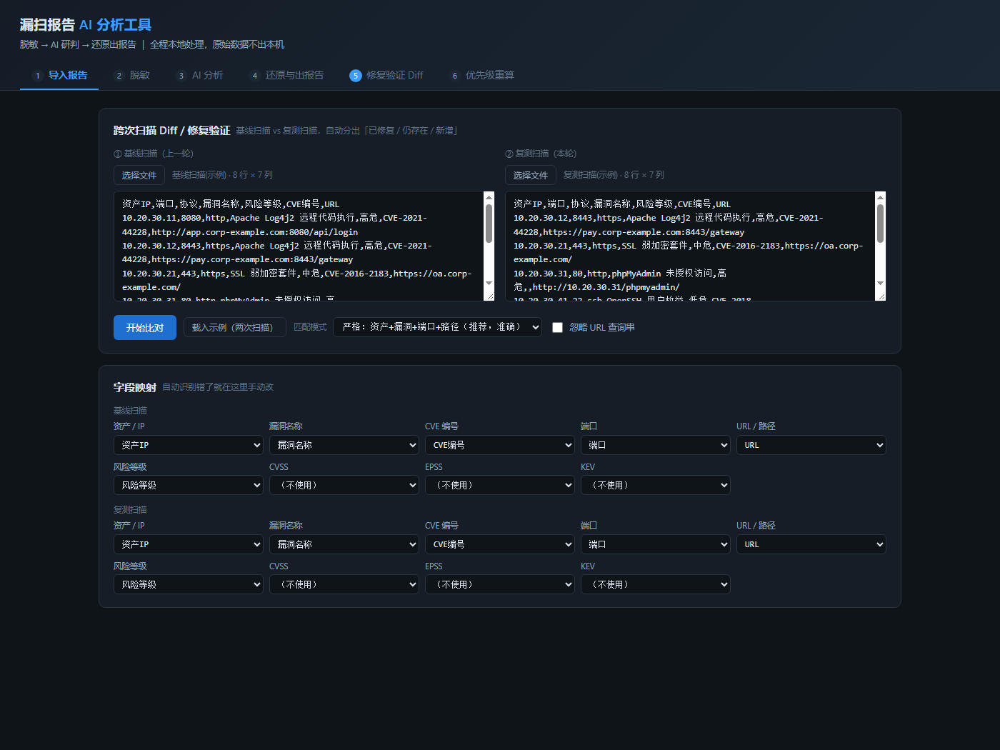
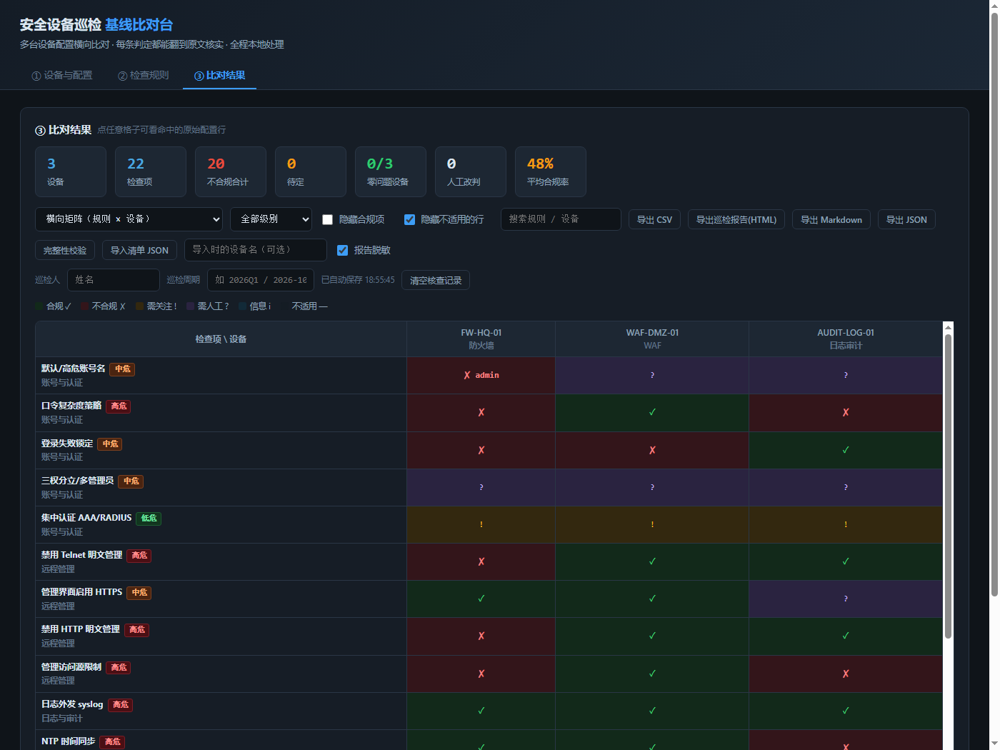
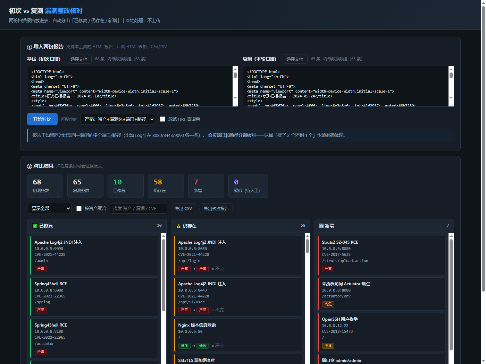
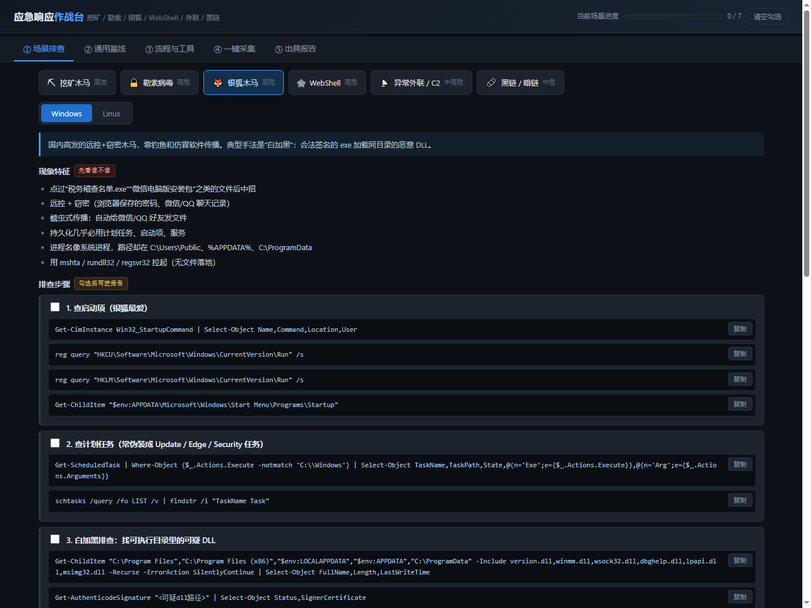
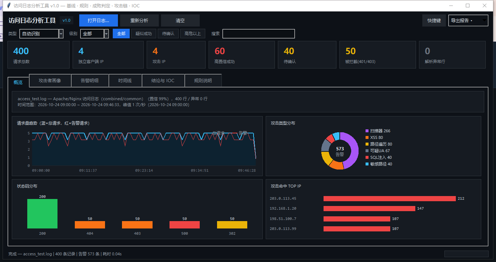

# 安全运营工具集 · Security Ops Toolkit

> 面向一线安服 / 应急响应场景的 5 个本地化工具。
> **零依赖、零安装、零数据外传** —— 单文件双击即用，所有处理都在本机完成。

[](#)
[](#)
[](#)
[](LICENSE)

---

## 为什么做这些

安服和应急的日常里，有大量时间花在**重复但不复杂**的事情上：

- 漏扫报告几十上百条，要写研判结论；但报告里全是客户真实 IP 和域名，**直接喂给 AI 就是数据泄露**
- 巡检十几台安全设备，靠人肉翻配置对比基线，**漏项和误判都靠运气**
- 整改复测后要回答"上次那 57 个漏洞修了几个"，**手工核对一下午还容易错**
- 突发事件凌晨三点，**排查思路在脑子里、命令要现查**，越急越乱

这 5 个工具就是把这四件事固化成可复用的东西。共同的设计取舍：

| 原则 | 具体做法 |
|---|---|
| **数据不出本机** | 纯前端 / 纯本地 Python，不联网、不上传、无埋点 |
| **单文件交付** | HTML 工具没有任何构建步骤，拷贝一个文件就能用 |
| **判定必须可追溯** | 每条结论都能点开看命中的原始行 / 证据，不给你一个"黑盒分数" |
| **不确定就标不确定** | 宁可标"待确认 / 疑似"，也不硬凑一个结论 |

---

## 工具清单

### 1️⃣ 漏扫报告 AI 分析工具



**问题**：想让 AI 帮忙研判漏扫报告，但报告含客户真实资产，不能直接发出去。

**做法**：六步流水线 —— `导入 → 脱敏 → AI 研判 → 还原出报告 → 修复验证 Diff → 优先级重算`

- 把 IP / 域名 / 邮箱替换成 `[[IP_001]]` 这类占位符，**只把脱敏版发给 AI**
- AI 返回的结论里带占位符，再用本地 `mapping.json` **一键还原成真实资产**
- 支持厂商 HTML / CSV / TXT 报告，自动识别表格字段
- 附带跨次扫描 Diff、基于 EPSS + KEV + 资产上下文的优先级重算

**亮点**：脱敏是**可逆**的，AI 全程只见占位符，但最终报告是完整资产信息。这是"用 AI 处理敏感数据"的核心矛盾，工具把它解开了。

📄 [使用说明](01-漏扫报告AI分析工具/使用说明.md)

---

### 2️⃣ 安全设备巡检基线比对台



**问题**：等保 / 基线巡检要逐台核对 WAF、IPS、防火墙配置，几十项检查点靠肉眼比对，且结论没法举证。

**做法**：把配置文本丢进去，规则引擎自动比对，输出「合规 / 不合规 / 不适用」，每条判定都能展开看**命中的原始配置行**。

- 内置 22 条安全设备基线项（账号、远程管理、日志审计、口令策略、访问控制…）
- 支持多设备横向对比：一份配置一列，同一检查项跨设备一眼看出谁不合规
- 导入「安全巡检剧本运行器」的清单 JSON，自动按设备拆列
- 导出 CSV / Markdown / HTML 报告，等保条款映射到二级子类（8.1.2 / 8.1.3 / 8.1.4 / 8.1.5）

**亮点**：判定不做黑盒。注释行不计入、`undo` 排除、原始自动判定与人工改判同时保留（带 `*` 标记），出问题时能解释每一条为什么这么判。

📄 [使用说明](02-安全设备巡检基线比对台/使用说明.md)

---

### 3️⃣ 初测 vs 复测对比工具



**问题**：整改复测后要回答三个问题——修了几个？还剩几个？新冒出来几个？手工核对费时且容易错。

**做法**：两份扫描报告放进去，自动分出**已修复 / 仍存在 / 新增 / 疑似**四类。

- 匹配键可切：`资产+漏洞名+端口+路径`（严格）或 `资产+漏洞名`（宽松）
- **同一漏洞的多端口多路径分别核对**：Log4j 在 8080/8443/9090 各一条，修了 2 个还剩 1 个，能精确体现
- 严格匹配不上但宽松能配上的，单独归入「疑似（需人工）」，**不直接算已修复**
- 等级变化（中危→高危）会标出来
- 支持厂商 HTML 表格、内嵌 JS 数据、CSV 三种来源

**亮点**：解决的是"改了个端口被误判成已修复"这类真实误判。解析器按引号状态做括号配对，能处理证据字段里的 `${jndi:ldap://}` 这种内容。

---

### 4️⃣ 应急响应作战台



**问题**：突发事件时排查思路在脑子里、命令要现查，越急越乱；不同事件类型（挖矿 / 勒索 / 银狐 / WebShell / 外联 / 黑链）× 不同平台（Linux / Windows）有不同打法。

**做法**：选事件类型 + 选平台，直接给出该场景的完整处置链。

- **现象特征** → **排查步骤（命令可一键复制）** → **满足什么才算「确认存在」** → **止损建议** → **清除修复** → **后续加固**
- 12 个场景组合（6 类事件 × 2 平台），Windows 侧强调白加黑、WMI 订阅、IFEO 劫持；Linux 侧强调 `/proc/*/exe` 指向 deleted、`ld.so.preload` 劫持
- 通用基线页：账号、服务、计划任务、启动项、注册表、网络、日志
- **一键生成只读采集脚本**（PowerShell 12 个采集分节 / Bash 15 个），跑完自动打包并算 SHA256
- 勾选的排查项 + 手填结论 → 导出应急响应报告（HTML / Markdown）

**亮点**：脚本**只读**，不删文件、不停服务、不改配置；PowerShell 脚本带 UTF-8 BOM，避免 5.1 把中文当 GBK 读而解析失败。

---

### 5️⃣ 访问日志图形化分析工具（Python）



**问题**：应急时拿到一份 `access.log`，grep 能找出攻击特征，但判断"到底成没成功"全靠经验。

**做法**：桌面 GUI，把访问日志分析固化成「基线 → 规则 → 成败判定 → 行为聚合 → 攻击链」五层。

- 22 条正则规则 + 12 类内置规则（SQLi / XSS / 路径遍历 / 命令执行 / 敏感路径 / 扫描器 UA…）
- **三级成败判定**：疑似成功（有强证据）/ 待确认（证据不足）/ 仅探测（被拦截）
- 主动识别**兜底页陷阱**：同一响应大小被大量路径共用时，提示"响应大小不能作为成功依据"
- 自绘图表（趋势 / 环形 / 柱状 / 横条），支持对数刻度
- 导出 HTML 报告 / CSV / JSON，也有无界面命令行模式

**亮点**：不把 404 当没事、也不把模板页 200 当成功 —— 这是纯 grep 分析最容易翻车的两个地方。

📄 [README](05-日志分析GUI/README.md)

---

## 技术要点

| 方向 | 具体实现 |
|---|---|
| **可逆脱敏** | 占位符编号 + 映射表分离；脱敏规则覆盖 IPv4/IPv6、域名、邮箱、MAC；还原时按最长匹配优先，避免 `[[IP_1]]` 误配 `[[IP_10]]` |
| **规则引擎** | 正则 + 语义判定分层；注释行 / `undo` 命令排除；证据留痕到行号；人工改判与自动判定并存 |
| **差分比对** | 双键策略（严格 / 宽松）+ 疑似缓冲，避免"改了端口算已修复" |
| **解析鲁棒性** | 三种报告格式自适应；括号配对扫描忽略字符串内的 `{}`；CSV 完整转义 |
| **编码处理** | UTF-8 BOM 策略（PowerShell 5.1 会把无 BOM 的 UTF-8 当 GBK）、GBK 兼容、BOM 剥离 |
| **界面** | 原生 JS 无框架；Canvas 自绘图表；`localStorage` 断点续做；DPI 感知；键盘快捷键 |
| **测试** | Node 单元测试 + Chrome headless DOM 测试；PowerShell AST 解析校验生成脚本；`bash -n` 校验 shell |

---

## 快速开始

**HTML 工具**：直接双击打开，不需要装任何东西。

```bash
# 克隆后
start 01-漏扫报告AI分析工具/漏扫报告AI分析工具.html
```

**Python 工具**：需要 Python 3.8+（仅标准库，无需 pip）。

```bash
cd 05-日志分析GUI
python log_analyzer_gui.py your_access.log
```

---

## 目录结构

```
security-toolkit/
├── 01-漏扫报告AI分析工具/      # 脱敏 + AI 研判 + 可逆还原
├── 02-安全设备巡检基线比对台/   # 多设备配置基线横向比对
├── 03-初测复测对比工具/        # 两次扫描结果差分
├── 04-应急响应作战台/          # 6 类事件 × 2 平台处置链 + 采集脚本
├── 05-日志分析GUI/            # access.log 图形化分析（Python）
└── docs/                      # 界面截图
```

---

## 免责声明

这些工具用于**授权的**安全测试、巡检与应急响应工作。

- 请仅在获得明确授权的资产上使用
- 工具本身不发起任何攻击行为，只做**本地数据解析与比对**
- 所有处理都在本机完成，不上传、不联网、不收集数据
- 使用前请自行评估是否符合所在组织的安全策略

---

## License

[MIT](LICENSE)
